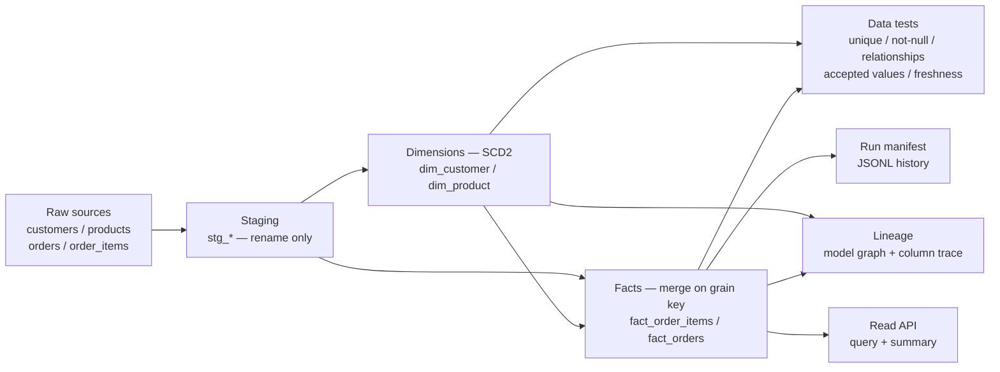

# Architecture

## Diagram (Mermaid)

ASCII equivalent: sources → staging → dimensions → facts, with tests,
lineage, manifests and the read API all derived from the same model
declarations (never from separate, drift-prone documentation).

## Build flow

1. `dag.plan(models)` topologically sorts models (Kahn's algorithm,
   alphabetical tie-break). Unknown dependencies raise `ValueError`;
   cycles raise `CycleError` naming the participants.
2. Each model builds in order via `builders.build_model`:
   - **Staging:** projection/rename pass over its single dependency.
   - **Dimension:** for each staging row, keyed by business key —
     new key → insert current row; tracked attribute changed → close
     the current row (`valid_to` = effective date, `is_current` =
     false) and open a new one; unchanged → no-op.
   - **Fact:** resolve each business key to the *current* surrogate
     key of its dimension (fail closed if none exists), compute
     declared measures, then merge on `grain_key` into any existing
     fact rows (replace on key, append new keys).
3. `tests_engine.run_tests` evaluates declarative tests against the
   built tables and returns per-test pass/fail with failing-row samples.
4. `manifest.ManifestStore` records models built, row counts, and the
   test tally, appending to a JSONL history file when a path is given.

## Lineage

Model lineage follows `depends_on` edges. Column lineage follows
`Column.source_columns`: a staging rename traces to its source column;
a fact measure traces to every input column it reads. `trace_column`
walks upstream to a raw source, so "where did `line_total` come from?"
is answered from declarations, not by reading SQL.

## Known limits (honest scope)

- No delete/tombstone handling in SCD2: a business key absent from a
  later load keeps its last current row. Adding tombstones is a small
  builder change (close rows missing from the load).
- No late-arriving-dimension handling: facts fail if no current
  dimension row exists, rather than creating inferred members. That
  fail-closed choice is intentional for a governed mart; inferred
  members would hide source gaps.
- The store is in-memory. For production volume, implement the `Store`
  interface over a real warehouse; DAG, builders, tests and lineage
  are store-agnostic.
- Measures are a fixed registry (`line_total`, `order_total`) rather
  than an expression language — again deliberate: measures that cannot
  be listed cannot be audited.

## CI

`docs/github-actions-ci.yml` is the CI workflow definition. It is
shipped under `docs/` (not `.github/workflows/`) because the GitHub App
used for publishing lacks the Workflows permission; activating it is a
one-step move to `.github/workflows/ci.yml`.
